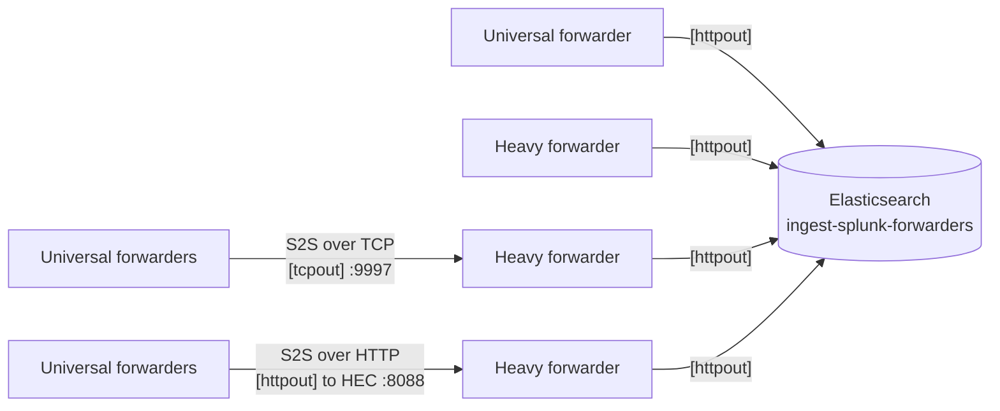
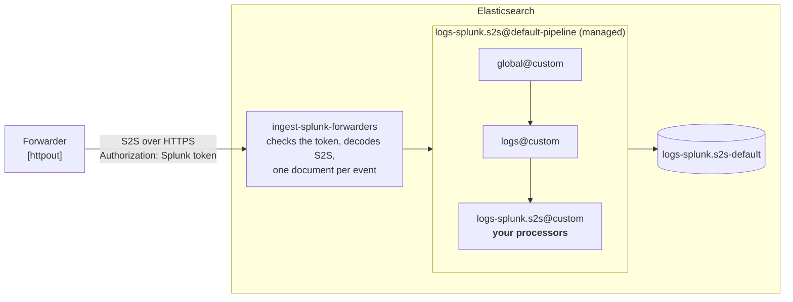

# elastic-ingest-splunk-forwarders

An Elasticsearch plugin that receives **Splunk forwarder** data directly. Universal and heavy forwarders (8.1 to
10.6) keep their inputs; only `outputs.conf` changes, from `[tcpout]` to `[httpout]`.

> **Community project**, not an official Elastic product, and not affiliated with or endorsed by Splunk. Each zip
> works with exactly one Elasticsearch version. Splunk is a trademark of Splunk LLC; Elastic and Elasticsearch are
> trademarks of Elasticsearch B.V.

Four ways in, all ending in `[httpout]` to Elasticsearch:



Forwarders already sending to a heavy forwarder, over TCP or HTTP, stay as they are; only the heavy forwarder's
`outputs.conf` changes.

Inside Elasticsearch:



The `@custom` pipelines run only if they exist; yours is where parsing goes.

## Install

Download the zip for your Elasticsearch version from [Releases](../../releases/latest).

* **Self-managed:** `bin/elasticsearch-plugin install file:///path/to/ingest-splunk-forwarders-<version>-es<es>.zip` on every node, then a rolling restart.
* **Elastic Cloud:** Extensions → create a *plugin* extension with the zip, then enable it on the deployment.

## Set up

Let forwarders reach the plugin (user settings or `elasticsearch.yml`). The role is built in and has no privileges:

```yaml
xpack.security.authc.anonymous.username: s2s_anonymous
xpack.security.authc.anonymous.roles: splunk_forwarders_anonymous
xpack.security.authc.anonymous.authz_exception: false
```

Give the plugin a key to write with, and store its `encoded` value in the keystore as `splunk_forwarders.api_key`
(Cloud: Security → Elasticsearch keystore), then `POST _nodes/reload_secure_settings`:

```
POST _security/api_key
{"name":"splunk-forwarders","role_descriptors":{"writer":{"indices":[{"names":["logs-*-*","metrics-*-*"],"privileges":["create_doc","auto_configure"]}]}}}
```

Create a token. Elasticsearch stores only its SHA-256; the name becomes `splunk.token_name`:

```bash
TOKEN=$(python3 -c "import uuid; print(uuid.uuid4())"); printf %s "$TOKEN" | sha256sum
```

```
PUT _cluster/settings
{"persistent":{"splunk_forwarders.token_sha256":["dc1-linux=<sha256>"]}}
```

Point the forwarders at it, in an app of its own (`etc/apps/to_elastic/local/outputs.conf`):

```ini
[httpout]
httpEventCollectorToken = <token>
uri = https://<elasticsearch-endpoint>:443
batchSize = 65536
batchTimeout = 5
```

A universal forwarder also needs `[thruput] maxKBps = 0` in `limits.conf` (its default cap is 256 KB/s). A heavy
forwarder also needs `[indexAndForward] index = false`.

## Test it

```bash
curl https://<elasticsearch-endpoint>/services/collector/s2s/health      # {"text":"HEC is healthy","code":17}
curl -X POST -H "Authorization: Splunk $TOKEN" https://<elasticsearch-endpoint>/services/collector/s2s
                                                                          # {"text":"Success","code":0}: token and key work
```

```esql
FROM logs-splunk.s2s-default | STATS events = COUNT(*) BY splunk.host, splunk.sourcetype
```

## Documents

Events land in `logs-splunk.s2s-default`. `message` is the event as the forwarder sent it; host, source,
sourcetype, index and channel come from the S2S protocol into `splunk.*`. `agent.type` is the
sender's product as Splunk names it, `splunkforwarder` or `splunk`; events a heavy forwarder relays keep the
originating forwarder's over TCP, and carry the heavy forwarder's (`splunk`) over HTTP. `event.module` is `splunk_forwarders`: the plugin that received it. Nothing is lost when
Elasticsearch is busy: the forwarder keeps a batch until it is all indexed, and a resend never duplicates.
Parse in the `logs-splunk.s2s@custom` ingest pipeline, which the plugin's default pipeline calls for every event.
An event Elasticsearch rejects (your pipeline fails, a mapping conflict) is not resent: it goes to the stream's
failure store, `logs-splunk.s2s-default::failures`, on by default for `logs-*-*`; with the failure store off it is
dropped, with a warning in the Elasticsearch log.

`@timestamp` is Splunk's `_time` (also in `splunk.time`) for events the forwarder parsed: `INDEXED_EXTRACTIONS`,
and everything a heavy forwarder sends. For raw text a universal forwarder sends, Splunk finds the time at the
indexer, so `@timestamp` is when the forwarder read the line: parse the event's own time in your pipeline.
Raw text becomes one event per line; an indented line (a stack trace) continues the event before it.

`splunk.fields` is flattened: one field whatever indexed fields a forwarder sends; query keys as
`splunk.fields.<key>` (in ES|QL, with `KQL()` or `QSTR()`).

## Metrics

Metric events (a heavy forwarder's log-to-metrics, such as its own `_metrics`) carry `event.kind: metric`, with
their measurements as numbers in `splunk.fields`. Send them to a metrics stream from your pipeline; the key above
can write there, and Elasticsearch's built-in `metrics` template maps the measurements as numbers:

```
PUT _ingest/pipeline/logs-splunk.s2s@custom
{"processors":[{"reroute":{"if":"ctx.event?.kind == 'metric'","destination":"metrics-splunk.s2s-default"}}]}
```

Shape them before the `reroute`, with the same `if`: the processors after it don't run for those events, and the
built-in `metrics` template has no pipeline of its own. A universal forwarder sends statsd or collectd lines as
raw text, not metric events; parse those in the same pipeline and reroute them too.

## Settings

| setting | default | |
|---|---|---|
| `splunk_forwarders.token_sha256` | — | allowed tokens, `name=<sha256>`; each `PUT` replaces the list |
| `splunk_forwarders.target` | `logs-splunk.s2s-default` | data stream; `{sourcetype}` / `{index}` placeholders |
| `splunk_forwarders.metadata` | `minimal` | `full`: also record the S2S stream state and request details |
| `splunk_forwarders.templates.enabled` | `true` | `false`: manage the `logs-splunk.s2s-*` index template yourself |
| `splunk_forwarders.api_key` | — | keystore; the identity events are indexed as |

All but the keystore entry are cluster settings: change one at any time, no restart.

The plugin's index template (flattened `splunk.fields`, the default pipeline) covers `logs-splunk.s2s-*`. For one
stream per sourcetype keep it by putting the placeholder in the namespace, `logs-splunk.s2s-{sourcetype}`. A
target outside `logs-splunk.s2s-*`, such as `logs-splunk.{sourcetype}-default`, gets Elasticsearch's built-in `logs`
template instead: every indexed field becomes a field of its own, and of the `@custom` pipelines only `logs@custom`
runs, not `logs-splunk.s2s@custom`.

```
PUT _cluster/settings
{"persistent":{"splunk_forwarders.target":"logs-myapp-default"}}

# back to the default
PUT _cluster/settings
{"persistent":{"splunk_forwarders.target":null}}
```

`GET _cluster/settings?include_defaults&filter_path=*.splunk_forwarders*` shows them.

## Build

```bash
./build-plugin.sh                     # Elasticsearch 9.5.4 -> dist/ (Docker only; runs the tests)
ES_VERSION=9.5.5 ./build-plugin.sh
```
